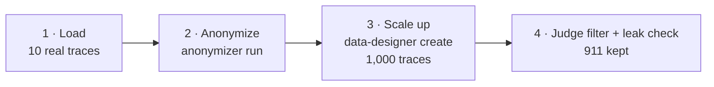
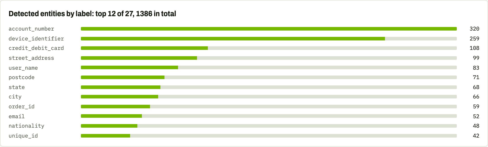

---
date:
  created: 2026-10-19
readtime: 7
authors:
  - mvansegbroeck
---

# **Anonymize a Few, Generate Many: Scaling Up Private Agent Traces**

<!-- SPDX-FileCopyrightText: Copyright (c) 2025-2026 NVIDIA CORPORATION & AFFILIATES. All rights reserved. -->
<!-- SPDX-License-Identifier: Apache-2.0 -->

Agent logs are some of the best training and eval data a team has, and some of the hardest to share. The personal data isn't only in what the customer types: tool calls carry it as arguments, tool results return whole customer profiles, and the agent repeats them back.

You don't need to anonymize all of them. In this note we take a **small subset, 10 real agent traces**, and anonymize those carefully with NeMo Anonymizer. Then NeMo Data Designer **scales that subset up to 1,000 new traces**, using the redacted ones as seeds for the format and tool-use pattern and giving every new trace its own fictional customer. Anonymization is the careful, per-record step; Data Designer adds the volume and the variety. The whole path is two CLI calls in one bash script, running on a local GLiNER2 detector and a self-hosted LLM, so no trace text leaves infrastructure you control.

<!-- more -->

<div style="text-align: center;" markdown>

![Two traces side by side. On the left, a redacted seed trace in which the customer's email, name and zip code are replaced by tokens such as [REDACTED_EMAIL] and [REDACTED_POSTCODE]. On the right, one of the synthetic traces generated from it, in OpenAI chat format, for a new fictional customer with a matching email, user ID and address in the tool results.](assets/agent-traces-seed-vs-synthetic.png){ loading=lazy }

</div>

---

## The Dataset: tau-bench Retail

The traces come from [τ-bench](https://github.com/sierra-research/tau-bench), Sierra Research's benchmark for tool-using agents. In its retail domain, an agent handles customer-service requests (cancellations, returns, exchanges, address changes) by calling tools such as `find_user_id_by_email`, `get_user_details` and `get_order_details`. The customers are fictional, but the traces look exactly like production agent logs, which makes them a safe stand-in for the real thing.

We use the Hugging Face packaging [`lefft/tau-dev-task-retail-v1`](https://huggingface.co/datasets/lefft/tau-dev-task-retail-v1) (MIT license, like upstream τ-bench):

- **915 conversations** (765 train, 50 validation, 100 test): GPT-4o and Claude 3.5 Sonnet trajectories from τ-bench's historical runs, kept only when the task succeeded (`reward == 1.0`).
- **Three columns.** `messages` holds the whole conversation in OpenAI tool-calling format, `tools` holds the tool schemas offered to the agent, and `metadata` holds the record ID, source model and per-role token counts.
- **Personal data in every channel.** The customer gives an email or a name plus zip code, the agent passes it to a tool, and the tool returns the full profile: name, street address, city, state, zip, email, payment methods and order IDs.

There is nothing to download or authenticate: the script reads rows straight from the [Hugging Face Dataset Viewer API](https://huggingface.co/docs/dataset-viewer/rows), which returns them as JSON.

---

## The Plan: A Few In, Many Out



The pipeline is one bash script, `run.sh`, plus a small `jq` filter and three YAML files: the model endpoints, the Anonymizer model roles, and the Data Designer recipe. They live in
[`docs/devnotes/posts/assets/agent-traces/`](https://github.com/NVIDIA-NeMo/Anonymizer/tree/main/docs/devnotes/posts/assets/agent-traces).
Both sizes are environment variables, `N_TRACES` (default 10) and `N_SYNTHETIC` (default 1,000). Each step prints a timestamped line, and the whole run is saved to `run_<date>_<time>.log` next to the script.

The excerpts below come from one run on a single GPU serving `openai/gpt-oss-120b` with vLLM: 10 traces anonymized in about 4 minutes, 986 synthetic traces generated in 43 minutes, 911 kept.

---

## Step 1: Load a Small Subset

```bash
curl -fsS "https://datasets-server.huggingface.co/rows?dataset=lefft/tau-dev-task-retail-v1&config=default&split=train&length=${N_TRACES:-10}" \
  | jq '[.rows[].row]' > raw.json
jq -r -f transcript.jq raw.json > traces.csv
```

Anonymizer takes one text column per row, so `transcript.jq` flattens each conversation into a single transcript with a chat-template marker at the start of every turn (`<|user|>`, `<|assistant|>`, `<|tool_call:NAME|>`, `<|tool_result|>`) and drops the shared retail-policy system prompt. It stays **one record per trace**, so Anonymizer treats the email in the user turn, the tool-call argument and the tool result as the same entity.

```text
[12:13:13] 1/4 load 10 tau-bench retail traces
[12:13:14] loaded 10 traces, one transcript per trace -> traces.csv
```

A few turns from one of the 10 transcripts:

```text
<|user|> daikisanchez1479@example.com

<|tool_call:find_user_id_by_email|> {"email": "daikisanchez1479@example.com"}

<|user|> Oh, I'm Daiki Sanchez and my zip is 46236

<|tool_call:find_user_id_by_name_zip|> {"first_name": "Daiki", "last_name": "Sanchez", "zip": "46236"}

<|tool_result|> daiki_sanchez_3253
```

---

## Step 2: Anonymize the Subset with `anonymizer run`

```bash
anonymizer run --source traces.csv --id-column trace_id --replace redact \
  --excluded-entity-labels monetary_amount --excluded-entity-labels country \
  --data-summary "Retail support agent traces. Each turn starts with a chat-template role marker (<|user|>, <|assistant|>, <|tool_call:NAME|>, <|tool_result|>); markers are structure, never entities. Tool results are JSON customer profiles with addresses, emails, payment methods and order IDs." \
  --model-configs anonymizer_models.yaml --model-providers model_providers.yaml \
  --output anonymized.parquet
```

- `--replace redact` swaps every detected entity for a label token such as `[REDACTED_EMAIL]`.
- `--excluded-entity-labels` drops prices and `country` (always "USA" here): they drive the task and identify no one.
- `--data-summary` tells the detection LLM what it is reading, which matters for JSON tool output and for the role markers.

**Three models, one job each.** GLiNER2 runs locally and proposes candidate spans. The self-hosted LLM validates each candidate in context, then looks for anything GLiNER2 missed. The same three roles run for every replace strategy.

```text
[12:13:50] [INFO] 🔧 Anonymizer initialized with 2 model configs
[12:13:50] [INFO]   |-- 🔎 detector:  gliner
[12:13:50] [INFO]   |-- ✅ validator: llm
[12:13:50] [INFO]   |-- 🧩 augmenter: llm
[12:13:50] [INFO] 📂 Loaded 10 records from traces.csv (column: 'text')
```

**Detection is where the time goes.** 1386 entities across the 10 traces, in under four minutes.

```text
[12:13:50] [INFO] 🔍 Running entity detection on 10 records
[12:13:50] [INFO] detection labels in scope: (default: 65 labels; see anonymizer.DEFAULT_ENTITY_LABELS for list)
[12:17:15] [INFO]   |-- 📋 Detection complete — 1386 entities found across 10 records (0 failed) [205.2s]
[12:17:15] [INFO]   |-- labels: account_number=320, device_identifier=259, credit_debit_card=108, street_address=99, user_name=83, postcode=71, state=68, city=66, order_id=59, email=52, nationality=48, unique_id=42, first_name=25, last_name=19, company_name=16, employment_status=15, customer_id=11, url=8, time=3, bank_routing_number=3, ssn=3, ipv4=2, cvv=2, refund_amount=1, language=1, vehicle_identifier=1, certificate_license_number=1
```

The label line is the quickest sanity check on a new dataset. Here the IDs in the JSON tool results (account numbers, item and product IDs tagged as `device_identifier`, payment-method IDs, user names, order IDs) far outnumber the names and emails in the conversation itself.

<div style="text-align: center;" markdown>

{ loading=lazy }

</div>

**Redact costs nothing extra.** No LLM call is needed to write a label token, so replacement takes 0.0 s. `Substitute` would add a generation pass here.

```text
[12:17:15] [INFO] 🔄 Running Redact replacement
[12:17:15] [INFO]   |-- 📋 Replacement complete (0 failed) [0.0s]
[12:17:15] [INFO] 🎉 Pipeline complete — 10 records processed, 0 total failures
```

The same turns as in step 1, after redaction:

```text
<|user|> [REDACTED_EMAIL]

<|tool_call:find_user_id_by_email|> {"email": "[REDACTED_EMAIL]"}

<|user|> Oh, I'm [REDACTED_USER_NAME] and my zip is [REDACTED_POSTCODE]

<|tool_call:find_user_id_by_name_zip|> {"first_name": "[REDACTED_FIRST_NAME]", "last_name": "[REDACTED_LAST_NAME]", "zip": "[REDACTED_POSTCODE]"}

<|tool_result|> [REDACTED_USER_NAME]
```

---

## Step 3: Scale Up to 1,000 with `data-designer create`

```bash
data-designer create upscale.yaml -n 1000 -d synthetic -o artifacts -f jsonl --no-tui
```

Data Designer builds every new row as a small graph of columns. The seed is `anonymized.parquet`, so the generator only ever sees the 10 redacted traces. Five samplers make each of the 1,000 rows different, an LLM column writes the trace, and a second LLM column judges it.

```yaml
seed_config:
  source: {seed_type: local, path: anonymized.parquet}
  sampling_strategy: shuffle

processors:
  - {processor_type: drop_columns, name: drop_original, column_names: [text, text_with_spans, final_entities]}

columns:
  - name: scenario        # 7 retail tasks: cancel, return, exchange, modify, change address, ...
  - name: temperament     # friendly, impatient, confused, frustrated, chatty
  - name: auth_path       # email (60%) or name plus zip code (40%)
  - name: outcome         # success 55%, change of mind 15%, policy refusal 20%, human hand-off 10%
  - name: customer
    column_type: sampler
    sampler_type: person_from_faker
    params: {locale: en_US}
  - name: trace           # llm-structured, output_format = OpenAI chat messages
  - name: trace_quality   # llm-judge: realism and consistency, 1-5
```

With 7 scenarios, 5 temperaments, 2 authentication paths and 4 outcomes, there are 280 combinations before the persona and the seed even come in, so 10 seeds are enough to get 1,000 traces that differ in more than names.

### Personas fill in what Anonymizer redacted

Anonymizer only redacts. The seed has no names, emails, addresses or IDs left, just tokens like `[REDACTED_FIRST_NAME]`. Data Designer gives every new trace its own persona: the `customer` sampler draws a fictional person from Faker (name, street, city, state and zip code), and the writer prompt tells the model to use that person and invent a matching email, user ID, order IDs and payment methods:

```text
Personal details in the example are redacted as [REDACTED_<LABEL>] tokens; never output such tokens,
use the customer details below instead.
...
- Customer: {{ customer.first_name }} {{ customer.last_name }}, {{ customer.street_number }} {{ customer.street_name }},
  {{ customer.city }}, {{ customer.state }} {{ customer.postcode }}. Invent a matching email, a user id
  (firstname_lastname_NNNN), order ids (#W + 7 digits), item ids and payment methods.
```

So the redacted slots come back filled with realistic values that belong to nobody, and each of the 1,000 traces gets a different customer. In the trace at the top of this note, the persona was Michelle Frazier, 154 Marc Unions, East Alicialand, Pennsylvania 58673, and the writer invented `michelle.frazier@example.com` and `michelle_frazier_2748` to match. Realistic values matter for training: a model fine-tuned on `[REDACTED_EMAIL]` learns to output redaction tokens, and real traffic never contains them.

### 1,000 rows from 10 seeds

The log shows the scale-up directly: 1,000 rows drawn from a seed dataset of 10, in shuffled order, so each redacted trace is reused about 100 times with different sampled values.

```text
[12:17:21] [INFO] ⚡️ Async generation: 2 column(s) (column 'trace', column 'trace_quality'), 2000 tasks across 1 row group(s)
[12:17:21] [INFO] 🚀 (1/1) Dispatching with 1000 records
[12:17:21] [INFO] 🎲 (1/1) Preparing samplers to generate 1000 records across 5 columns
[12:17:21] [INFO] 🌱 (1/1) Sampling 1000 records from seed dataset
[12:17:21] [INFO]   |-- seed dataset size: 10 records
[12:17:21] [INFO]   |-- sampling strategy: shuffle
```

!!! warning "Dropped is not deleted"
    The config drops the pre-redaction columns that Anonymizer's output carries, but Data Designer still saves dropped columns to `artifacts/<dataset>/dropped-columns-parquet-files/`. `run.sh` deletes that folder right after generation, so the original traces don't sit next to the synthetic ones.

---

## The Result

`run.sh` ends with a short `jq` filter that keeps the traces the LLM judge scored at least 4 on both realism and consistency, and in which every tool result follows its call. It then checks that none of the emails from the 10 source traces appear anywhere in the output.

```text
[13:00:07] 4/4 filter: judge scores >= 4 and every tool result follows its call; then check for leaked emails
[13:00:07] done: kept 911 / 986 synthetic traces, no original emails -> out/synthetic.jsonl
```

Each line of `synthetic.jsonl` is one trace in the same OpenAI `messages` format as the source dataset, with the sampled settings alongside:

??? example "One synthetic trace as JSON (two messages and the metadata)"

    ```json
    {
      "messages": [
        {
          "role": "assistant",
          "tool_calls": [
            {
              "id": "call_1",
              "type": "function",
              "function": {
                "name": "find_user_id_by_email",
                "arguments": "{\"email\":\"michelle.frazier@example.com\"}"
              }
            }
          ]
        },
        {
          "role": "tool",
          "content": "{\"user_id\":\"michelle_frazier_2748\"}",
          "tool_call_id": "call_1"
        }
      ],
      "metadata": {
        "scenario": "update the default address on the user profile",
        "temperament": "impatient",
        "auth_path": "name plus zip code",
        "outcome": "request violates policy and is politely refused"
      }
    }
    ```

---

## Try It

You need `curl`, `jq`, Python with `nemo-anonymizer[notebooks]` (which brings `data-designer`), and an OpenAI-compatible LLM endpoint; point `model_providers.yaml` at it. `run.sh` starts the local GLiNER2 detector that ships with Anonymizer if nothing is listening on `:8001`. Then, from the
[`agent-traces`](https://github.com/NVIDIA-NeMo/Anonymizer/tree/main/docs/devnotes/posts/assets/agent-traces) folder:

```bash
./run.sh                                    # 10 traces anonymized, 1,000 generated
N_TRACES=50 N_SYNTHETIC=5000 ./run.sh       # more seeds, more traces
```
